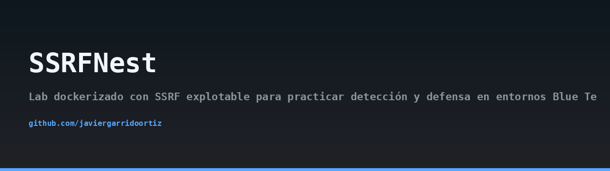
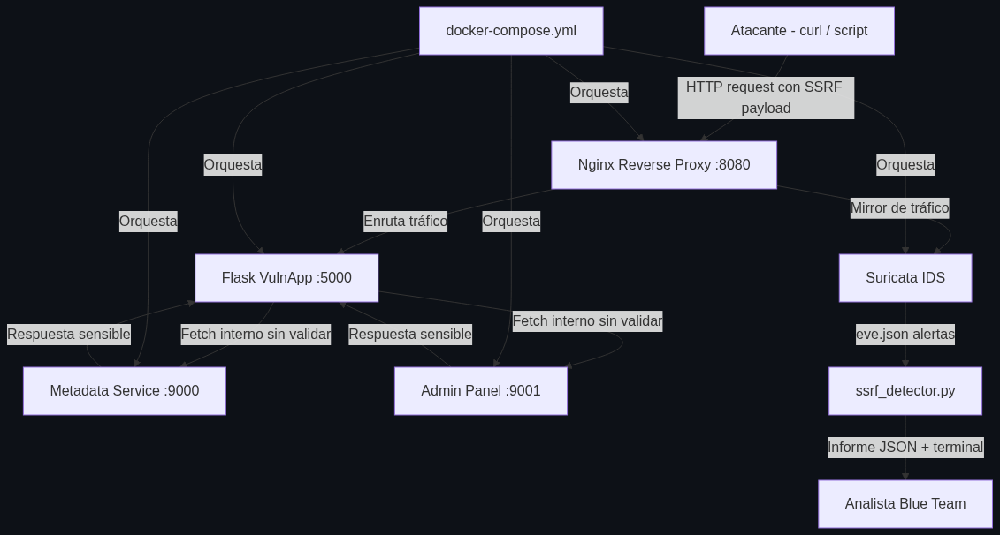
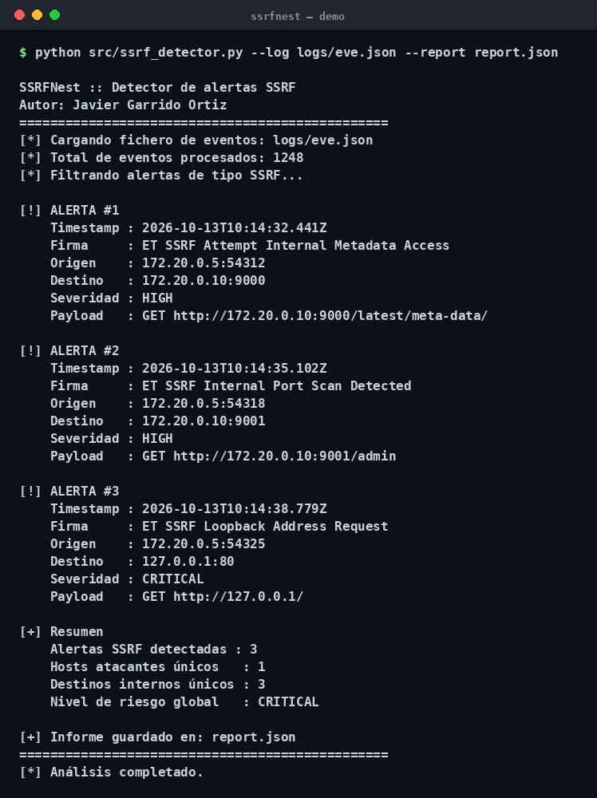

## Arquitectura



## Demo



> 🇬🇧 Read this in [English](README.en.md).

# SSRFNest


> ⚠️ **Este laboratorio es únicamente para fines educativos en entornos controlados.**
> SSRFNest contiene vulnerabilidades intencionadas. **No lo despliegues en redes
> públicas, corporativas ni accesibles desde Internet.** El autor no se hace
> responsable del uso indebido del contenido de este repositorio.

## Descripción

SSRFNest es un laboratorio dockerizado diseñado para que equipos **Blue Team**
practiquen la detección y el análisis de ataques **SSRF (Server-Side Request
Forgery)** en un entorno realista. Levanta una aplicación Flask deliberadamente
vulnerable, un servicio de metadatos simulado al estilo AWS IMDSv1, un panel de
administración interno y un IDS Suricata 7 que captura el tráfico y genera
alertas correlacionables.

La motivación es clara: SSRF es una de las vulnerabilidades más explotadas en
entornos cloud (capital One 2019, GitLab, etc.), pero rara vez se practica con
un stack de detección completo. SSRFNest cubre el ciclo entero:
**explotación → captura → alerta → informe**.

## Diagrama de flujo

```
  [ Atacante ]
       |
       v
  +------------+      +---------------------+
  |  Nginx     | ---> |  Flask VulnApp      |
  |  :8080     |      |  /fetch?url=...     |
  +-----+------+      +----------+----------+
        |                        |
        | mirror                 +--> http://metadata:9000/meta-data/...
        v                        +--> http://adminpanel:9001/admin/...
  +------------+
  |  Suricata  |  --> logs/eve.json
  |  IDS 7.x   |
  +------------+
                     +---------------------+
                     |  ssrf_detector.py   |
                     |  informe JSON+rich  |
                     +---------------------+
```

## Arquitectura

El laboratorio se compone de **cinco servicios Docker** orquestados con
Docker Compose:

1. **vulnapp** (`services/vulnapp`) — Flask 3.x expuesto en el puerto interno
   5000. Su endpoint `/fetch?url=` realiza peticiones HTTP sin validar la URL
   destino, permitiendo SSRF a cualquier host alcanzable desde el contenedor.
2. **nginx** (`services/nginx`) — Proxy inverso en el puerto **8080** que expone
   la VulnApp al exterior y espeja el tráfico hacia Suricata.
3. **metadata** (`services/metadata`) — Simulación de AWS IMDSv1 en el puerto
   **9000**. Devuelve credenciales ficticias, rol IAM y datos de instancia.
4. **adminpanel** (`services/adminpanel`) — Panel interno en el puerto **9001**,
   accesible sólo desde la red Docker interna. Expone `/admin/` con datos
   sensibles simulados.
5. **suricata** — Suricata 7 en modo IDS con reglas personalizadas en
   `suricata/rules/ssrf.rules`. Escribe alertas en `logs/eve.json`.

## Requisitos previos

- Docker **24+**
- Docker Compose **v2** (`docker compose`, no `docker-compose`)
- Python **3.11+** (para el detector y el script de ataque)
- Linux/macOS recomendado. En Windows usa WSL2.

## Instalación

```bash
git clone https://github.com/<tu-usuario>/ssrfnest.git
cd ssrfnest

# Levantar el laboratorio entero
docker compose up -d

# Verificar que los 5 contenedores están en marcha
docker ps --format 'table {{.Names}}\t{{.Status}}\t{{.Ports}}'
```

Instala las dependencias Python del detector y del script de ataque:

```bash
python -m venv .venv
source .venv/bin/activate
pip install -r requirements.txt
```

## Uso

### a) Ejecutar el ataque de demostración

El script `scripts/attack_demo.py` lanza una batería de payloads SSRF contra la
VulnApp para poblar los logs de Suricata:

```bash
python scripts/attack_demo.py --target http://localhost:8080
```

Cada payload toca un vector distinto: loopback, RFC-1918, servicio de metadatos,
panel de admin y bypass con DNS rebinding simulado.

### b) Ver alertas de Suricata en tiempo real

```bash
docker logs -f ssrfnest-suricata
```

Verás líneas JSON con `event_type: alert` y la firma disparada, por ejemplo
`SSRF Attempt to Internal Metadata Service`.

### c) Analizar las alertas con el detector

```bash
python src/ssrf_detector.py --log logs/eve.json --report report.json
```

Salida típica en terminal (rich):

```
SSRFNest Detector — Informe de alertas
┏━━━━━━━━━━━━━━━━━━━━━━━━━┳━━━━━━━━━━━┳━━━━━━━━━━━━━━━━━━━━━━━━━━━━━━━━┓
┃ Timestamp               ┃ Severity  ┃ Signature                      ┃
┡━━━━━━━━━━━━━━━━━━━━━━━━━╇━━━━━━━━━━━╇━━━━━━━━━━━━━━━━━━━━━━━━━━━━━━━━┩
│ 2024-05-12T10:14:02.123 │ 1 (High)  │ SSRF Attempt to Metadata       │
│ 2024-05-12T10:14:03.441 │ 2 (Med)   │ SSRF Attempt to RFC1918 Range  │
│ 2024-05-12T10:14:04.902 │ 1 (High)  │ SSRF Attempt to Admin Panel    │
└─────────────────────────┴───────────┴────────────────────────────────┘
Total alertas: 3  |  Hosts únicos: 1  |  Informe: report.json
```

El informe JSON contiene, por cada alerta: `timestamp`, `signature`,
`severity`, `src_ip`, `dest_ip`, `http.hostname`, `http.url` y `payload`
(cuando Suricata lo registra).

## Endpoints vulnerables de la VulnApp

| Endpoint | Método | Descripción |
|---|---|---|
| `/fetch?url=` | GET | Petición HTTP arbitraria sin validación. Vector principal. |
| `/proxy` | POST | Reenvía el cuerpo a la URL indicada en el JSON. |
| `/preview` | GET | Descarga una imagen remota por URL. SSRF ciego. |
| `/health` | GET | Endpoint sano, útil como control negativo. |

## MITRE ATT&CK

- **T1090.002 — Proxy: Internal Spearphishing.** SSRF se usa como pivote hacia
  servicios internos no expuestos (metadata, adminpanel).
- **T1078 — Valid Accounts.** El servicio de metadatos simulado devuelve
  credenciales ficticias que, en un entorno real, permitirían escalar
  privilegios y acceder a la cuenta cloud.
- **T1552.005 — Unsecured Credentials: Cloud Instance Metadata API.** Vector
  clásico cubierto por el servicio `metadata`.

## Reglas Suricata

El fichero `suricata/rules/ssrf.rules` define firmas específicas para este lab:

- `sid:1000001` — Petición HTTP cuyo `Host` apunta a `169.254.169.254` o
  `metadata` (servicio IMDS). Severidad alta.
- `sid:1000002` — Petición a rangos RFC-1918 (`10.0.0.0/8`, `172.16.0.0/12`,
  `192.168.0.0/16`). Severidad media.
- `sid:1000003` — Petición a `127.0.0.1` o `localhost` desde la VulnApp.
  Severidad media.
- `sid:1000004` — URI que contiene `/meta-data/` o `/admin/`. Severidad alta.

Las reglas se cargan desde `suricata/suricata.yaml` y el `eve.json` se escribe
en el volumen compartido `./logs`.

## Limpieza del laboratorio

```bash
docker compose down -v
rm -rf logs/ report.json
```

El flag `-v` elimina también los volúmenes asociados (logs de Suricata y
cualquier artefacto generado).

## Licencia

Distribuido bajo licencia **MIT**. Consulta el fichero [LICENSE](LICENSE) para
más detalles.

Autor: **Javier Garrido Ortiz**.
